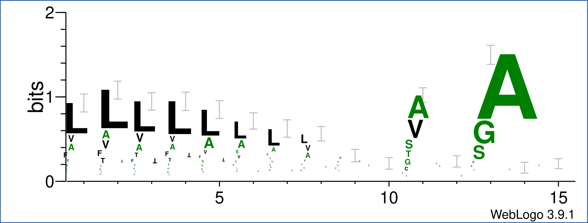
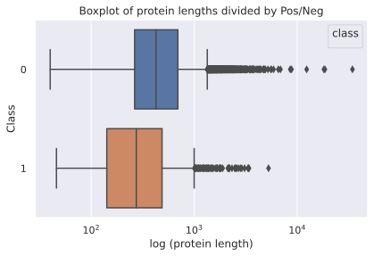

# DATA ANALYSIS:

## 1. AMINO ACID COMPOSITION:

## 2. CLEAVAGE SITE:
Starting from SP-containing sequences, we extract the cleavage-site region [-13, +2] and use the weeb tool WebLogo to produce a sequence logo. In this way, from the aligned subsequences, we obtained a graphical representation of sequence conservation. We produce two sequence logos, one for the training set and one for the test set in order to check that they are coherent. 

The two images result to be very similar. Both of them have a clear predominance of small hydrophobic residues in the first seven positions (in particular leucine, alanine and valine, where leucine is the most represented), a non conservative region in position 9 and 10, and a AXA motif in position [11, 13]. 

Sequence logo for the test set:

Sequence logo for the training set:

## 3. PROTEIN LENGTHS:

First of all we have checked how many different lenghts our data has, in the dataset taken in consideration of 9728 entries there are present
1687 different lengths. So the first step done was to have a look and understand the values of principal summary statistics like mean, median and variance. 

Is turned out that the negative class has an average length of 574 aa and the median value is 425, while for the positive class an average length of 400 aa and a median value 274. The means could be affected by outliers, but it seems there is a big difference in terms of length between the two groups, in fact the observed differences between the medians tells us that the positive proteins have a shorter overall length.

For the plots a total of 30 bins was selected for the histograms to provide a balance between the resolution of the protein length distribution and the readability of the plots.
Looking at the histogram with the density plot, it shows that for the class 0 (negative) there are more proteins and seems to follow a Normal distribution. In the case of the positive proteins the distribution seems to be more large and vary mostly between 50 and 1000 aa, while the negative goes from 50 to 5000 aa. In that latter case of positive class there isn't a bin with more entries, they are all quite similar, while for the negative its vary a lot.

Plotting the boxplot of the two classes, here we can see what said before, the negative class (0) has more data, in fact the boxplot is above the other one, and the mean and median are 574 and 425 respectively, while for the positive class are 400 and 274. Furthermore whiskers of the boxplot indicates that the negative class has more variance, that indicates these proteins have more different lenghts that the positive class which is more concentrared.

## 4. SP LENGTH:

The analysis of the length of the signal peptide was done only on the positive set. The cleavage position was considered as the length of the SP and plotted.

### SP length vs fold
The distributio length of the SP was compared between sets (each cross validation and test set) to assure that the proportion was maintained. 
As in the following graph, the density plots shows the distributions were maintained constant.

## 5. TAXONOMY:

### Kindom Distribution

### Species Composition

### Kindom Distribution by Fold

