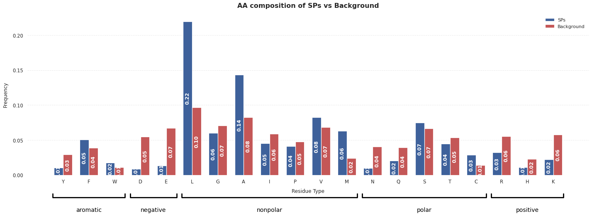
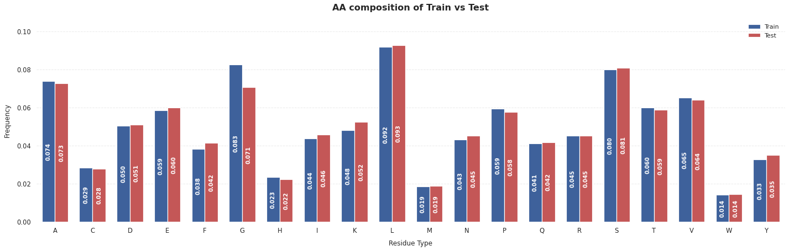
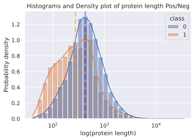
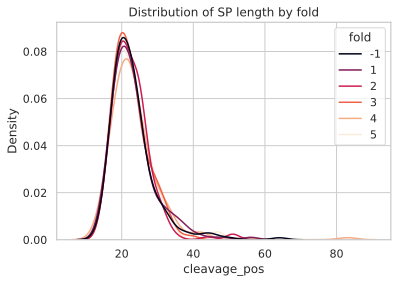
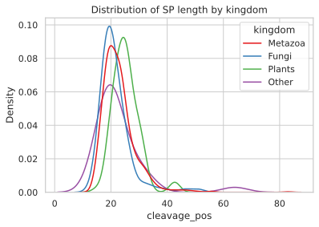
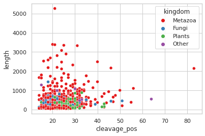
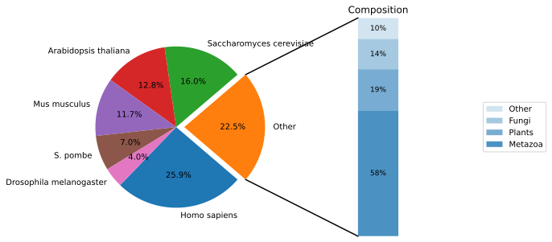
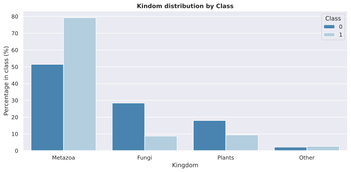
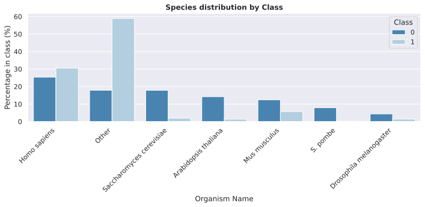

# Data analysis

Before training any model we checked that the dataset is biologically sensible and that the training folds and the hold-out test set are comparable. Each analysis has its own notebook; the notebooks locate the repository root by themselves and save their plots in their own folder.

| Analysis | Notebook | Outputs |
|---|---|---|
| Amino acid composition | `aa_composition_plots/aa_compositions.ipynb` | `background_freq.tsv`, `plots/*.png` |
| Cleavage site | `seq_logo_cleavage_region/cleavage_site.ipynb` | `cleavage_region_train.txt`, `cleavage_region_test.txt`, then the logos made with WebLogo |
| Protein length | `Prot_Len/protein_lengths.ipynb` | `Protein_Length_hist_dens.svg`, `Protein_Length_box.svg` |
| SP length | `SP_len/SP_length.ipynb` | `SP_length_by_fold.svg`, `SP_length_by_kingdom.svg`, `SP_len_seq_len.svg` |
| Taxonomy | `Taxonomy_analysis/taxonomy.ipynb` | `Kindom_Distribution`, `Species`, `Kingdom_Percentages_by_Fold`, `Kingdom_Percentages_by_Class`, `Species_Percentages_by_Class` (.png and .svg) |

## 1. Amino acid composition

Composition of the signal peptides (from residue 1 to the cleavage site, positive set) compared with the Swiss-Prot background. The background comes from `aa_composition_swissprot.tsv` and is saved as `background_freq.tsv`, which is also the background of the von Heijne PSWM.

- Hydrophobic residues (L, A, V) dominate the SP region, consistent with the sequence logos below; charged residues are under-represented.
- The methionine enrichment is an artifact: every sequence starts with Met, which is counted as part of the SP. Starting the count from the second residue removes it.

Composition of the positive sequences (whole sequences) in each training fold and in the test set: the five folds and the test set have practically the same composition.

## 2. Cleavage site

From every positive sequence we extracted the region around the cleavage site, from 13 residues before to 2 after (positions −13 to +2), separately for the training folds and the test set, and built a sequence logo of each with the WebLogo web server.

Training set:

Test set:

The two logos are very similar. Small hydrophobic residues (mostly leucine, then alanine and valine) dominate the first seven positions, positions 9 and 10 are not conserved, and positions 11–13 (−3 to −1) show the **AXA motif** that precedes the cleavage site.

## 3. Protein length

The 9728 proteins of the dataset have 1687 different lengths.

| Class | Mean length | Median length |
|---|---:|---:|
| Negatives (0) | 574.5 | 425 |
| Positives (1) | 399.0 | 274 |

Positive proteins are clearly shorter: the medians, which are not affected by the very long outliers, differ by about 150 residues.

Histograms with 30 bins (logarithmic x axis) and density curves, normalised separately for each class because negatives are many more than positives: negative proteins are longer and their lengths are more spread out.

The boxplot confirms it: the negative class has a higher median and a wider spread, while the lengths of the positive class are more concentrated.

## 4. SP length

Positive set only; the SP length is the cleavage position, i.e. the last residue of the signal peptide. The median is 22 residues (range 14–83).

The distribution is the same in every fold and in the test set, with a peak around 20 residues.

Distribution of the SP length in each kingdom (density curves normalised separately for each kingdom).

There is no apparent correlation between the length of a protein and the length of its signal peptide.

## 5. Taxonomy

We looked at the taxonomic distribution, at kingdom and species level, to make sure the fold split did not introduce imbalances.

Kingdoms in the whole dataset (positives and negatives); organisms outside Metazoa, Viridiplantae (Plants) and Fungi are grouped as "Other". Metazoa are the largest group (54.6%), followed by Fungi (26.2%) and Plants (17.0%).

The six most represented species (*Homo sapiens*, *Saccharomyces cerevisiae*, *Arabidopsis thaliana*, *Mus musculus*, *Schizosaccharomyces pombe*, *Drosophila melanogaster*); the bar on the right splits the remaining sequences by kingdom.

The kingdom proportions are almost identical in the five folds and in the test set.

The two classes have a different kingdom composition: Metazoa are 79% of the positives but 52% of the negatives, while Fungi are 9% of the positives and 28% of the negatives. A model could partly learn the kingdom instead of the signal peptide, which is worth keeping in mind when reading the results.

The same comparison for the six most represented species, with all the others grouped as "Other".
