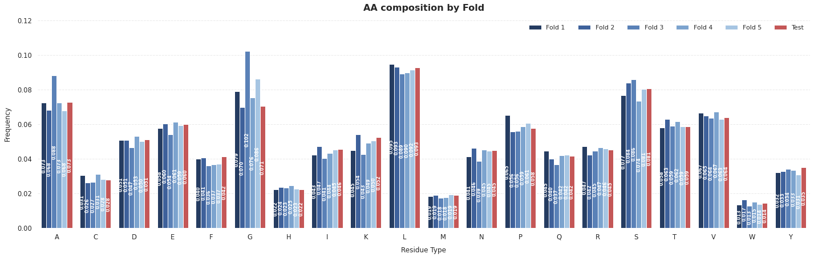
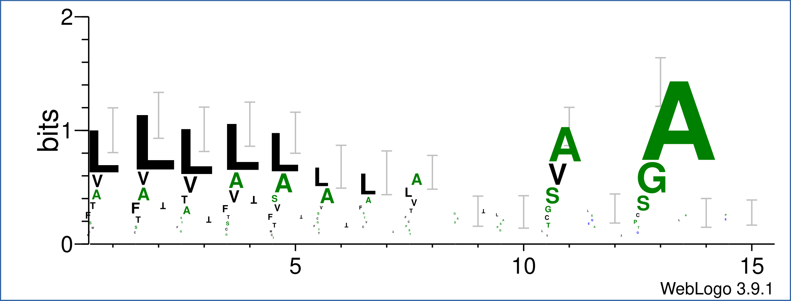
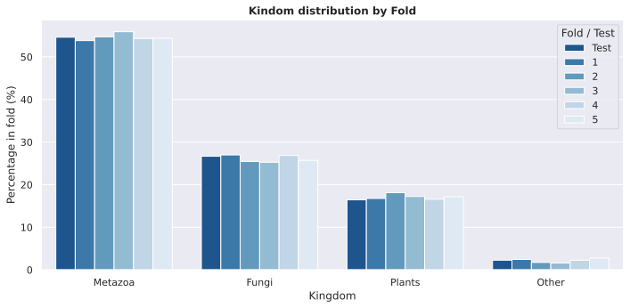

# DATA ANALYSIS:

## 1. AMINO ACID COMPOSITION:

__Informative findings__: hydrophobic residues (L, A, V) dominate at conserved SP positions, consistent with the seq logo; polar charged residues are under-represented.

__Methionine bias__: enrichment is an artifact (all sequences start with Met, included in the N-terminal SP). Shifting the slice by one position removes it.

__Safety check:__ AA composition is similar between the 5 k-folds and the test

## 2. CLEAVAGE SITE:
Starting from SP-containing sequences, we extract the cleavage-site region [-13, +2] and use the weeb tool WebLogo to produce a sequence logo. In this way, from the aligned subsequences, we obtained a graphical representation of sequence conservation. We produce two sequence logos, one for the training set and one for the test set in order to check that they are coherent. 

The two images result to be very similar. Both of them have a clear predominance of small hydrophobic residues in the first seven positions (in particular leucine, alanine and valine, where leucine is the most represented), a non conservative region in position 9 and 10, and a AXA motif in position [11, 13]. 

Sequence logo for the test set:

Sequence logo for the training set:

## 3. PROTEIN LENGTHS:

First of all we have checked how many different lenghts our data has, in the dataset taken in consideration of 9728 entries there are present
1687 different lengths. So the first step done was to have a look and understand the values of principal summary statistics like mean, median and variance. 

Is turned out that the negative class has an average length of 574 aa and the median value is 425, while for the positive class an average length of 400 aa and a median value 274. The means could be affected by outliers, but it seems there is a big difference in terms of length between the two groups, in fact the observed differences between the medians tells us that the positive proteins have a shorter overall length.

For the plots a total of 30 bins was selected for the histograms to provide a balance between the resolution of the protein length distribution and the readability of the plots.
Looking at the histogram with the density plot, it shows that for the class 0 (negative) proteins are generally longer that is because in this set has a lot of entries from different species, while for the positive group the proteins seems to be more specific because in this case we have the signal peptide.

Plotting the boxplot of the two classes, the negative class (0) has more data, in fact the boxplot is above the other one, and the mean and median are 574 and 425 respectively, while for the positive class are 400 and 274. Furthermore whiskers of the boxplot indicates that the negative class has more variance, that indicates these proteins have more different lenghts that the positive class which is more concentrared.

## 4. SP LENGTH:

The analysis of the length of the signal peptide was done only on the positive set. The cleavage position was considered as the length of the SP and plotted.

### SP length vs fold
The distribution of the SP length was compared between sets (each cross validation and test set) to assure that the proportion is maintained. 

As in the following graph, the density plots shows the distributions is constant around 20 residues for every fold.

### SP length agains protein length

The SP length was compared against the full protein length, to search for eventual biases.

This graph shows that there is no apparent correlation between the length of the sequence and the length of the signal peptide, probably due to an independent evolution of the two.
## 5. TAXONOMY:

We analyzed the taxonomic distribution at both the kingdom and species levels across the datasets to ensure that our fold splitting strategy did not introduce any unintended imbalances.
### Kindom Distribution

This plot represents the kingdom distribution within the overall dataset, comprising both positive and negative samples. Species that do not belong to the three primary eukaryotic kingdoms (Metazoa, Viridiplantae, and Fungi) were grouped under the "Other" label. As expected, the distribution shows that the vast majority of the sequences belong to Metazoa.
For the distribution it self, it can be see that the majority of teh sequence belong to the metazoa, as we would expect.

### Species Composition

This plot provides a more detailed taxonomic breakdown of the overall dataset. It highlights the six most highly represented species, while maintaining the broader kingdom-level classification for the remaining sequences.
### Kindom Distribution by Fold

This plot demonstrates that the taxonomic proportions are preserved across the data splits, showing an almost perfectly balanced kingdom distribution across the five cross-validation folds and the independent test set.
