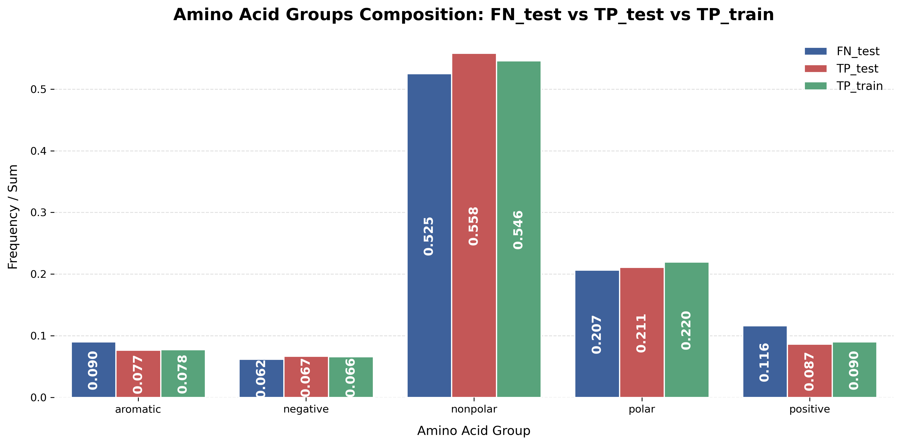
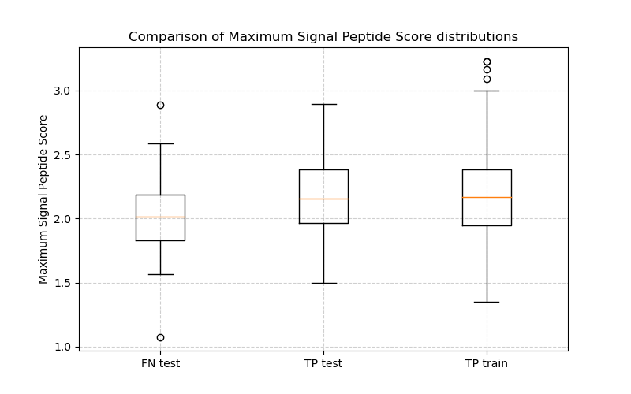
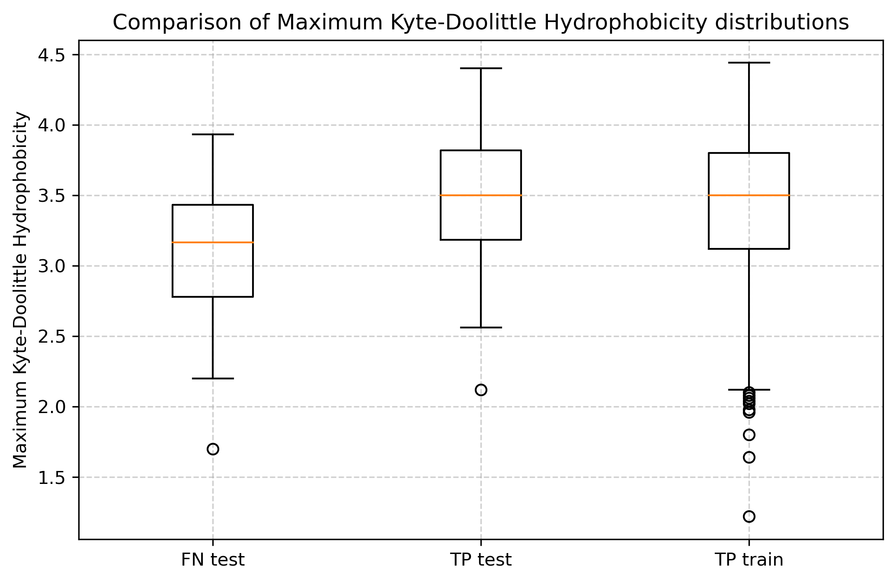

# Error Analysis
On the benchmarking set, we analyse the prediction errors in detail:
– False positives (FP): non-SP sequences predicted as SPs
– False negatives (FN): SPs predicted as non-SPs

## 1. General analysis

### Confusion matrices
=> TODO: fare grafico heatmap delle confusionmatrices

### FP and FN distribution among taxa
=> GRAFICI PAOLO

### FP and FN distribution among species
=> GRAFICI DI PAOLO

## 2. False Positive analysis
Many FPs are due to a hydrophobic transmembrane (TM) helix at the protein N-terminus. To understand the impact of this feature:
- Isolate the FP predictions in the benchmarking set
- Use metadata extracted from UniProtKB to compute the fraction of FPs that have a TM helix within the first 90 residues

In practice, instead of computing the total false positive rate (FPR) we compute the FPR focusing only on TM proteins:
FPR_tm = FP_tm / (FP_tm + TN_tm)

| Model | FPR | FPR_tm |
|---|---|---|
| Von Heijne | | |
| SVM | 0.0094 | 0.1132 |

Comparing FPR and FPR of proteins with a TM helix in the first 90 residues it can be observed that they differ from a factor of almost 10. This means that the model is 10 times more likely to wrongly call a positive, which should be classified as negative, if it contains a transmembrane helix. 

## 3. False Negative analysis 

### Von Heijne - FN analysis
*Hypothesis*: FNs may have a different composition of the cleavage-site context than expected.

For all FNs in the benchmark, we compute the corresponding sequence LOGO, then we compare it with the expected LOGO (=TP).

Possible problem: if the number of FN is low, the obtained sequence LOGO will be negativelly affected since for sequence LOGO more sequences we have better it is.

### SVM - FN analysis
*Hypothesis*: FNs may have feature values different from those learned on training positives.

If the number of FN is high, it means that there is a problem in the feature extraction because we choosen features that do not represent well the positive class with respect the negative one.

#### N-terminal composition (with the selected K)
FNs may have a different composition of the N-terminal region (selected K). We compare compositions up to K residues across the three groups (FN in benchmark set, TP in benchmark set, TP in train set).

While FP between train and test is coherent, the graph shows a slightly different composition for non polar residues between the FP and TP.
In particular, Alanine and Leucine, which are also known for beign important residues in the composition of the signal peptider are less represented, while the Proline shows an higher frequency. 

#### Group composition

To further analyze the overall distribution based on physical chemical properties was computed, showing that the frequencies are almos the same in TP for both train and test and FN of the test set. 

#### Signal peptide length 
FNs may have a longer or shorter SP than expected. We compare SP length distributions across the three groups (FN in benchmark set, TP in benchmark set, TP in train set).

#### Other adopted features
We compare the distributions of the first 3 most important features adopted (feature importance assigned using RF) across the three groups (FN in benchmark set, TP in benchmark set, TP in train set). 

In our case, the 3 most important features are:
1. kd_len --> number of contiguous residues around the max peak of kd hydrophobicity that are over the hydrophobicity threshold (= 2, chosen from literature)
2. signal_max --> max value obtained applying "Signal sequence helical potential" scale, namely the helix propensity measured on signal sequences
3. max_kd --> max value of Kyte-Dolittle (kd) hydrophobicity

We decide to visualize the three distributions using boxplot. What we expected to see is an higher similarity between TP in benchmark set and TP in train set, while the FN should be slightly different. 

