# Error Analysis
On the benchmarking set, we analyse the prediction errors in detail:
– False positives (FP): non-SP sequences predicted as SPs
– False negatives (FN): SPs predicted as non-SPs

## 1. General analysis

| Model | mcc | precision | recall | f1 | balanced accuracy |
|---|---|---|---|---|---|
| Von Heijne | 0.6771 | 0.6891 | 0.7421 | 0.7146 | 0.8496 |
| SVM | 0.8944 | 0.9167 | 0.8959 | 0.9062 | 0.9427 |
| CNN | 0.9132 | 0.9231 | 0.9231 | 0.9231 | 0.9566 |

    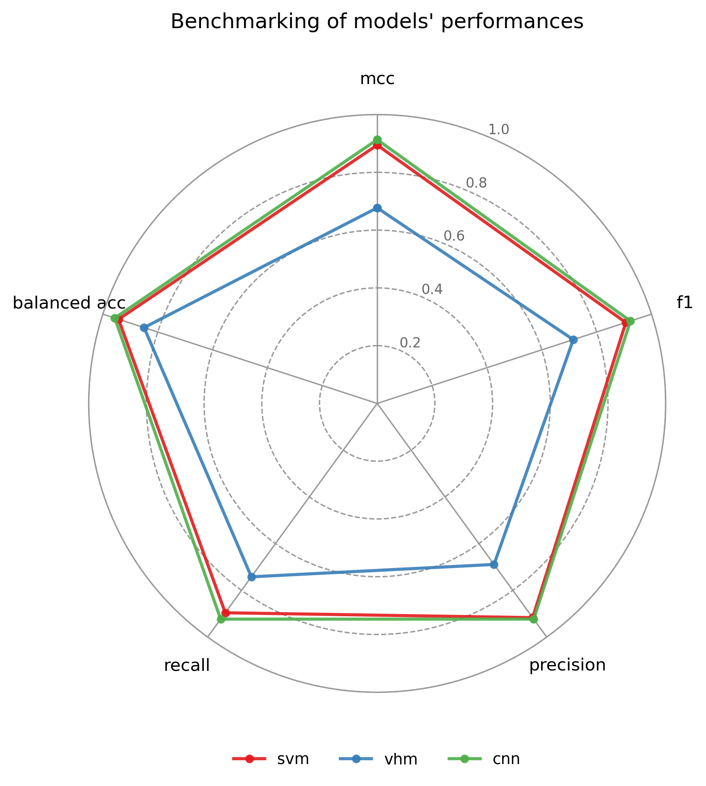

### Confusion matrices

<table>
  <tr>
    <th align="center">Von Heijne</th>
    <th align="center">SVM</th>
    <th align="center">CNN</th>
  </tr>
  <tr>
    <td align="center">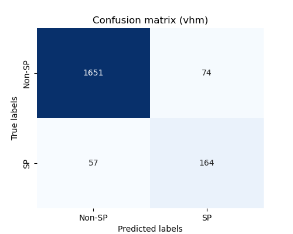</td>
    <td align="center"></td>
    <td align="center"></td>
  </tr>
</table>

### FP and FN distribution among taxa

<table>
  <tr>
    <th align="center">Von Heijne</th>
    <th align="center">SVM</th>
  </tr>
  <tr>
    <td align="center">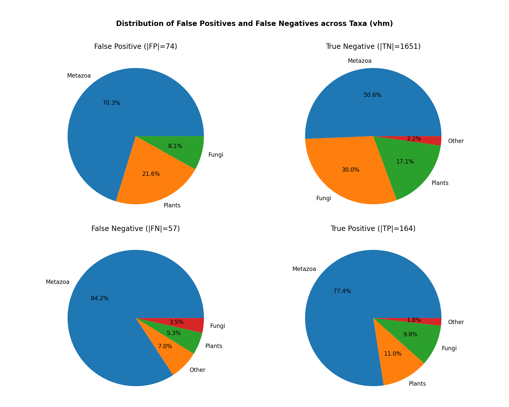</td>
    <td align="center">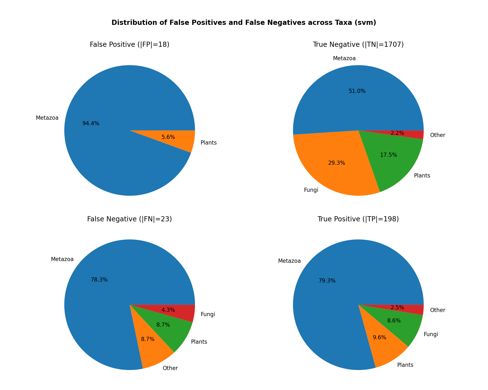</td>
  </tr>
</table>

### FP and FN distribution among species

<table>
  <tr>
    <th align="center">Von Heijne</th>
    <th align="center">SVM</th>
  </tr>
  <tr>
    <td align="center">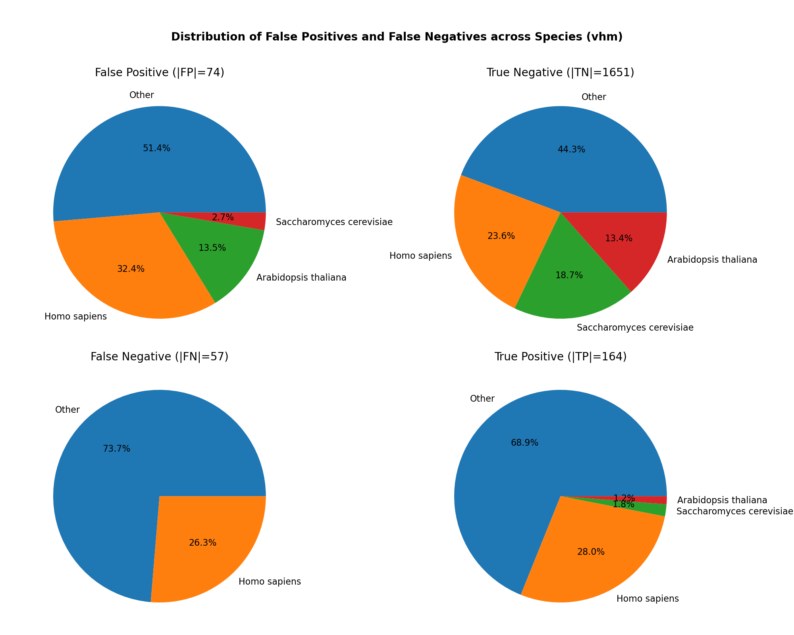</td>
    <td align="center">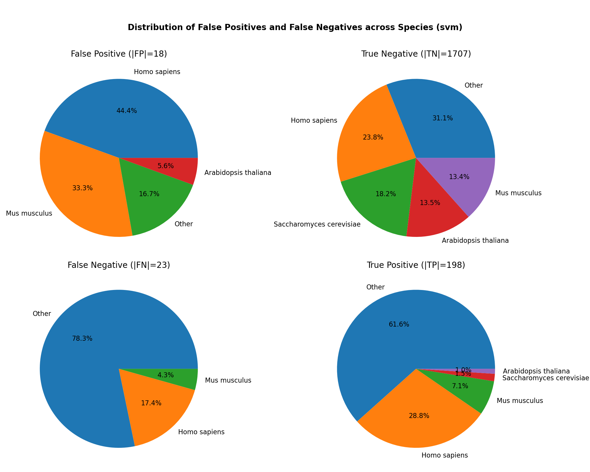</td>
  </tr>
</table>

## 2. False Positive analysis
Many FPs are due to a hydrophobic transmembrane (TM) helix at the protein N-terminus. To understand the impact of this feature:
- Isolate the FP predictions in the benchmarking set
- Use metadata extracted from UniProtKB to compute the fraction of FPs that have a TM helix within the first 90 residues

In practice, instead of computing the total false positive rate (FPR) we compute the FPR focusing only on TM proteins:
FPR_tm = FP_tm / (FP_tm + TN_tm)

| Model | FPR | FPR_tm |
|---|---|---|
| Von Heijne | 0.0408 | 0.1887 |
| SVM | 0.0094 | 0.1132 |
| CNN | 0.0089 | 0.0566 |

Comparing FPR and FPR of proteins with a TM helix in the first 90 residues it can be observed that they differ from a factor of almost 10. This means that the model is 10 times more likely to wrongly call a positive, which should be classified as negative, if it contains a transmembrane helix.

The CNN shows the lowest values for both FPR and FPR_tm, with the smallest increase when a TM helix is present, which makes it less susceptible to the influence of the TM during classification. Nevertheless, for all three models the presence of an N-terminal TM helix substantially increases the likelihood of a false positive, consistent with the structural and physicochemical similarity between the hydrophobic region of signal peptides and TM helices.

## 3. False Negative analysis

### Von Heijne - FN analysis
*Hypothesis*: FNs may have a different composition of the cleavage-site context than expected.

For all FNs in the benchmark, we compute the corresponding sequence LOGO, then we compare it with the expected LOGO (=TP).

Possible problem: if the number of FN is low, the obtained sequence LOGO will be negativelly affected since for sequence LOGO more sequences we have better it is.

<table>
  <tr>
    <th align="center">Expected (TP)</th>
    <th align="center">FN</th>
  </tr>
  <tr>
    <td align="center">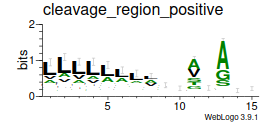</td>
    <td align="center"></td>
  </tr>
</table>

### SVM - FN analysis
*Hypothesis*: FNs may have feature values different from those learned on training positives.

If the number of FN is high, it means that there is a problem in the feature extraction because we choosen features that do not represent well the positive class with respect the negative one.

#### N-terminal composition (with the selected K)
FNs may have a different composition of the N-terminal region (selected K). We compare compositions up to K residues across the three groups (FN in benchmark set, TP in benchmark set, TP in train set).

    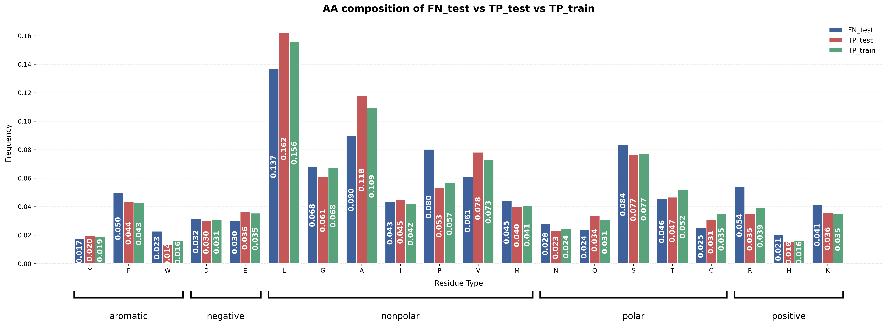

While FP between train and test is coherent, the graph shows a slightly different composition for non polar residues between the FP and TP.
In particular, Alanine and Leucine, which are also known for beign important residues in the composition of the signal peptider are less represented, while the Proline shows an higher frequency.

#### Group composition

To further analyze the overall distribution based on physical chemical properties was computed, showing that the frequencies are almos the same in TP for both train and test and FN of the test set.

#### Signal peptide length
FNs may have a longer or shorter SP than expected. We compare SP length distributions across the three groups (FN in benchmark set, TP in benchmark set, TP in train set).

<table>
  <tr>
    <th align="center">Group composition</th>
    <th align="center">Signal peptide length</th>
  </tr>
  <tr>
    <td align="center"></td>
    <td align="center">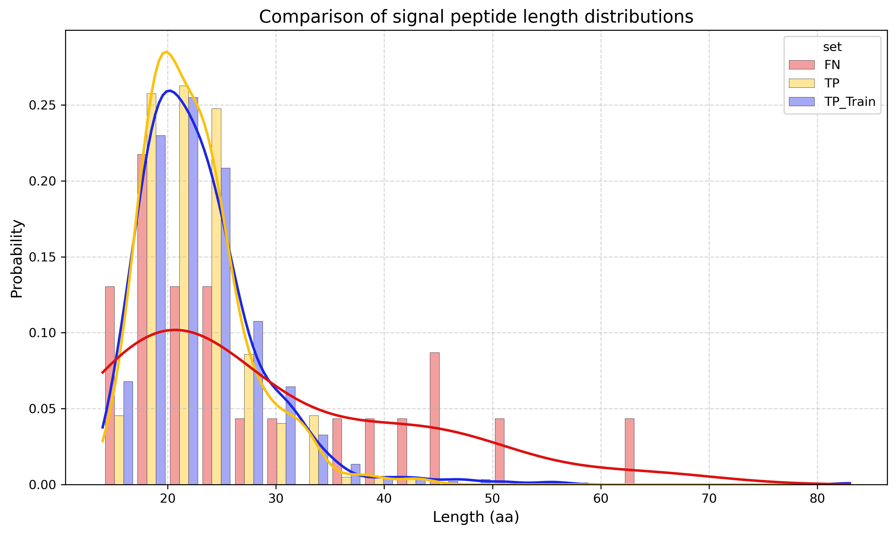</td>
  </tr>
</table>

#### Other adopted features
We compare the distributions of the first 3 most important features adopted (feature importance assigned using RF) across the three groups (FN in benchmark set, TP in benchmark set, TP in train set).

In our case, the 3 most important features are:
1. kd_len --> number of contiguous residues around the max peak of kd hydrophobicity that are over the hydrophobicity threshold (= 2, chosen from literature)
2. signal_max --> max value obtained applying "Signal sequence helical potential" scale, namely the helix propensity measured on signal sequences
3. max_kd --> max value of Kyte-Dolittle (kd) hydrophobicity

We decide to visualize the three distributions using boxplot. What we expected to see is an higher similarity between TP in benchmark set and TP in train set, while the FN should be slightly different.

<table>
  <tr>
    <th align="center">kd_len</th>
    <th align="center">signal_max</th>
    <th align="center">max_kd</th>
  </tr>
  <tr>
    <td align="center">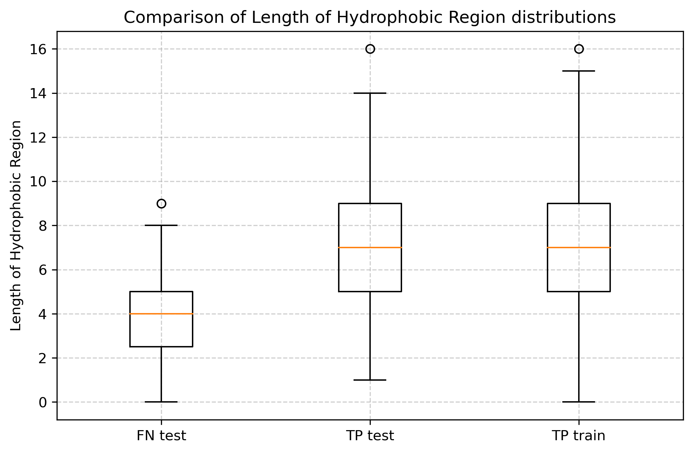</td>
    <td align="center">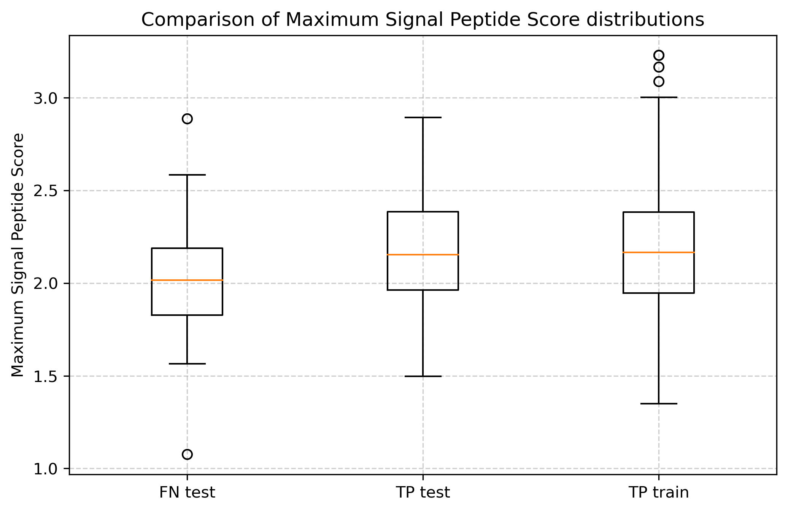</td>
    <td align="center"></td>
  </tr>
</table>

### CNN - FN analysis
*Hypothesis*: FNs may be related to the signal peptide length, as observed for the SVM.

Unlike the SVM, the CNN does not rely on a fixed-length feature window, so it is expected to be less affected by length-related biases. We compare the SP length distribution of the FNs with the one obtained for the SVM.

<table>
  <tr>
    <th align="center">SVM</th>
    <th align="center">CNN</th>
  </tr>
  <tr>
    <td align="center"></td>
    <td align="center"></td>
  </tr>
</table>

The CNN shows a substantially lower proportion of FNs among very short signal peptides (less than 20 amino acids) compared with the SVM, with the highest FN density observed around a signal peptide length of 30 amino acids. This suggests that the CNN is less affected by the length-related bias observed in the SVM, potentially due to the absence of fixed-length feature windows.