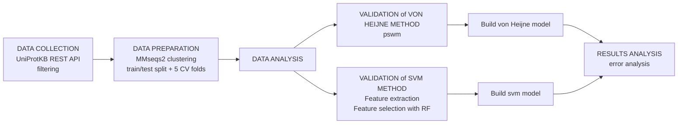

# Signal Peptide Prediction in Eukaryotic Proteins

LB2 project – Group 1. We predict whether a eukaryotic protein carries an N-terminal secretory **signal peptide (SP)**. The dataset is built from UniProtKB/Swiss-Prot, made non-redundant and split into a training and a hold-out test set; on it we compare a **von Heijne position-specific weight matrix (PSWM)** with a **support vector machine (SVM)** trained on physico-chemical features.

## Pipeline (FIXME: the structure can be kept but the nodes must modified to adapt to our pipeline)
Project work plan:
1. Retrive relevant datasets from UniProtKB.
2. Preprocess datasets for cross-validation and benchmarking.
3. Analyze and visualize dataset statistics.
4. Extract relevant features for classification.
5. Implement von Heijne's algorithm and SVM classifier.
6. Evaluates methods via cross-validation and blind test set.
7. Discuss and report results.



## Repository structure

| Folder | Main files | What it does |
|---|---|---|
| [`Data_collection/`](Data_collection/) | `data_collection.py` | Downloads the positive and negative sets from UniProtKB and writes them as TSV and FASTA |
| [`Data_preparation/`](Data_preparation/) | `Data_cleaning/remove_redundancy.py`, `datasplitting.py` | Removes redundancy (MMseqs2), splits training and test set, assigns the cross-validation folds |
| [`Data_analysis/`](Data_analysis/) | one notebook per analysis | Amino acid composition, cleavage-site logos, protein and SP length, taxonomy |
| [`von_Heijne_method/`](von_Heijne_method/) | `von_heijne_metrics.py` | PSWM baseline and its cross-validated evaluation for von Heijne method |
| [`SVM_method/`](SVM_method/) | `feature_extraction.py`, `feature_selection.py` | Feature extraction, feature selection and SVM in nested cross-validation to evaluate the svm method (not using the) |
| [`Models/`](Models/) | `SVM_final.py`, `von_heijne_metrics_final.py` | Train and test the two final models (svm, von heijne) for benchmarching. Use cross-validation to find hyperparameters. |

Each folder has its own README with the details.

## Dataset

| Step | Positives | Negatives |
|---|---:|---:|
| UniProtKB query and filters | 2961 | 19594 |
| After MMseqs2 clustering (30% identity, 40% coverage) | 1104 | 8624 |
| Training set (5 cross-validation folds) | 883 | 6899 |
| Hold-out test set | 221 | 1725 |

- **Positives**: reviewed, non-fragment eukaryotic proteins of at least 40 residues with evidence at protein level and an experimentally verified SP that starts at residue 1, is at least 14 residues long and is cleaved.
- **Negatives**: same constraints, no SP, and an experimentally verified localization in cytosol, nucleus, mitochondrion, plastid, peroxisome or cell membrane. Proteins also annotated in the endoplasmic reticulum, Golgi apparatus, extracellular space or as secreted are excluded.
- **Split**: stratified 80/20 split into training and test set; the training set is divided into 5 stratified folds (seed 42), each with about 177 positives and 1380 negatives.

All the later steps read `Data_preparation/Cleaned_merged_dataset.tsv`, one row per protein:

| Column | Content |
|---|---|
| `class` | 1 = signal peptide, 0 = no signal peptide |
| `ID` | UniProt accession |
| `organism_name`, `kingdom` | organism and kingdom (Metazoa, Fungi, Plants, Other) |
| `length` | protein length |
| `cleavage_pos` | last residue of the signal peptide (0 for negatives) |
| `early_trans` | helical transmembrane segment starting before residue 90 (negatives only) |
| `fold` | 1–5 = cross-validation fold, −1 = hold-out test set |

## Methods

**von Heijne (PSWM).** The 15 residues around the cleavage site (13 before, 2 after) of the positive training sequences give a log-odds matrix against the Swiss-Prot amino acid background, with pseudocount 1. A protein is scored by sliding the window over its first 90 residues and keeping the best score; the threshold is the one that maximises F1 on a validation fold.

**SVM.** Each protein is described by 37 features: 17 come from sliding-window profiles of 9 AAindex scales (hydrophobicity, charge, helix and β-sheet propensity, volume, signal-sequence helical potential, flexibility, mutability) on the first 40 residues, and 20 are the amino acid composition of the first 22 residues (the median SP length in the training set).

## Results obtained in the validation of the methods

von Heijne: in each of the 5 runs, 3 folds build the matrix, 1 fold chooses the threshold and 1 fold is used for testing. Mean ± standard error over the 5 runs (`von_Heijne_method/k_fold_stats.csv`):

| MCC | F1 | Precision | Recall | Accuracy |
|---:|---:|---:|---:|---:|
| 0.688 ± 0.039 | 0.722 ± 0.036 | 0.708 ± 0.050 | 0.745 ± 0.088 | 0.935 ± 0.008 |

SVM: A nested cross-validation on the 5 training folds chooses the number of features *k* (top *k* by Random Forest importance) and the RBF-SVM parameters *C* and γ in the inner loop, and measures the MCC of the chosen setting in the outer loop. Mean ± standard error over the nested cross-validation (see [`SVM_method/`](SVM_method/)).

| MCC |
|---:|
| 0.855 ± 0.009 | 

## Results of final models

von Heijne (`Models/vhm/von_heijne_metrics_final.py`).
SVM (`Models/SVM/SVM_final.py`).

| Model | MCC | F1 | Precision | Recall | Accuracy |
|---:|:---:|:---:|:---:|:---:|:---:|
| Von Heijne | 0.677 | 0.714 | 0.689 | 0.742 | 0.933 (normal acc) |
| SVM | 0.894 | 0.906 | 0.917 | 0.896 | 0.943 (balanced acc) |


## Data analysis highlights

- Hydrophobic residues (L, A, V) dominate the SP region, and the cleavage site shows the typical **AXA motif** at positions −3 and −1.
- Positive proteins are shorter than negative ones (median 274 vs 425 residues).
- The median SP length is 22 residues (range 14–83) and does not correlate with protein length.
- Amino acid composition, SP length and kingdoms are balanced across the 5 folds and the test set. The two classes differ in kingdom composition: Metazoa are 79% of the positives but 52% of the negatives.

Plots and details in [`Data_analysis/`](Data_analysis/).

## Installation

```bash
git clone https://github.com/Valentina-Piccoli/LB2_project_Group_1.git
cd LB2_project_Group_1
pip install -r requirements.txt
```

The project needs Python 3.6 or later (it runs on Python 3.6.11 on the course VM). `requirements.txt` lists numpy, pandas, scikit-learn (≥ 0.24), matplotlib, seaborn, biopython and requests; to open the notebooks you also need Jupyter (`pip install notebook`). Two external tools are needed only to regenerate some intermediate files: [MMseqs2](https://github.com/soedinglab/MMseqs2) for the clustering and the [WebLogo](https://weblogo.threeplusone.com/) web server for the sequence logos.

## How to run

Scripts find their files relative to their own location, so they can be launched from any folder; the commands below are run from the repository root. Every intermediate file is in the repository, so you can start from any step.

```bash
# 1. Download the datasets from UniProtKB (needs internet; overwrites the TSV/FASTA files in Data_collection/)
#    with -all the negative output prefix comes first
python3 Data_collection/data_collection.py -all Data_collection/negative/negative_set Data_collection/positive_set

# 2. Cluster each set with MMseqs2 (30% identity, 40% coverage)
mmseqs easy-cluster Data_collection/positive_set.fasta Data_preparation/Data_cleaning/positive_set.cluster/cluster-results-positive tmp --min-seq-id 0.3 -c 0.4 --cov-mode 0 --cluster-mode 1
mmseqs easy-cluster Data_collection/negative/negative_set.fasta Data_preparation/Data_cleaning/negative_set.cluster/cluster_result_negative tmp --min-seq-id 0.3 -c 0.4 --cov-mode 0 --cluster-mode 1

# 3. Keep only the cluster representatives
python3 Data_preparation/Data_cleaning/remove_redundancy.py Data_preparation/Data_cleaning/positive_set.cluster/cluster-results-positive_rep_seq.fasta Data_collection/positive_set.tsv Data_preparation/Data_cleaning/positive_set.clean
python3 Data_preparation/Data_cleaning/remove_redundancy.py Data_preparation/Data_cleaning/negative_set.cluster/cluster_result_negative_rep_seq.fasta Data_collection/negative/negative_set.tsv Data_preparation/Data_cleaning/negative_set.clean

# 4. Training/test split and folds -> Data_preparation/Cleaned_merged_dataset.tsv
python3 Data_preparation/datasplitting.py Data_preparation/Data_cleaning/positive_set.clean Data_preparation/Data_cleaning/negative_set.clean

# 5. One FASTA with all the non-redundant sequences (negatives first), read by the next steps
cat Data_preparation/Data_cleaning/negative_set.cluster/cluster_result_negative_rep_seq.fasta \
    Data_preparation/Data_cleaning/positive_set.cluster/cluster-results-positive_rep_seq.fasta \
    > von_Heijne_method/merged.fasta

# 6. von Heijne method: metrics, confusion matrices and spider plot in von_Heijne_method/
python3 von_Heijne_method/von_heijne_metrics.py --cm y --spider y

# 7. SVM: features -> Feature_Selection/feature.csv, nested cross-validation -> Feature_Selection/results_svm_rf.txt (long run)
python3 Feature_Selection/feature_extraction.py
python3 Feature_Selection/feature_selection.py
```

The background amino acid frequencies used by the PSWM (`Data_analysis/aa_composition_plots/background_freq.tsv`) are computed by `aa_compositions.ipynb` from the Swiss-Prot composition statistics. The notebooks locate the repository root by themselves, so they work wherever the repository is cloned.

## Authors

Group 1 – Piccoli V., Rammal A., Acazi D., Zarcone P., Giavatto L. I.
