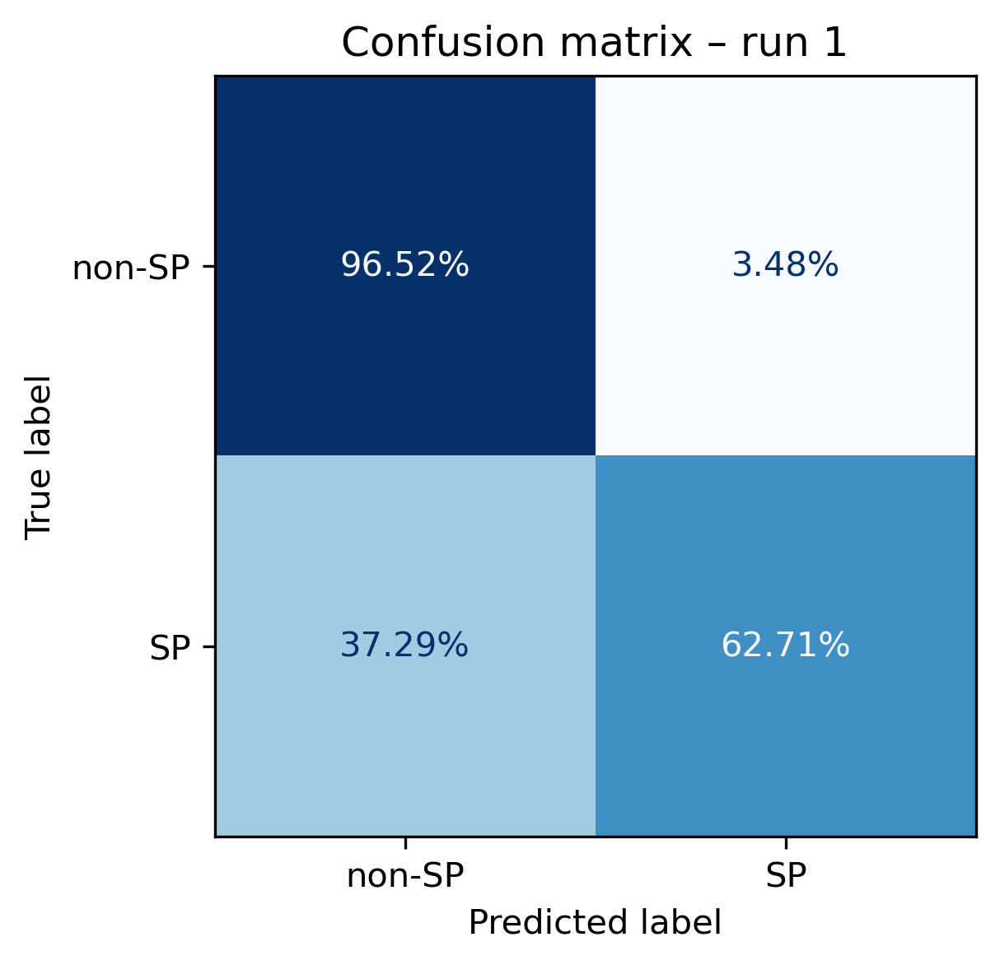
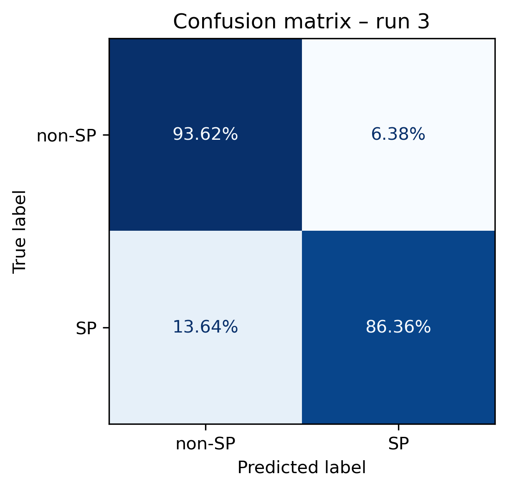
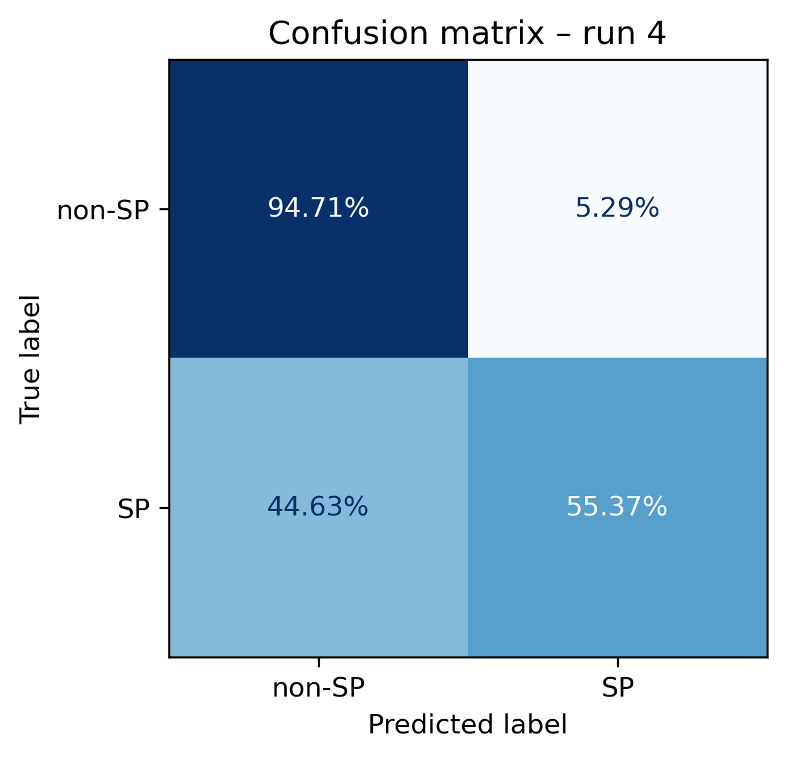
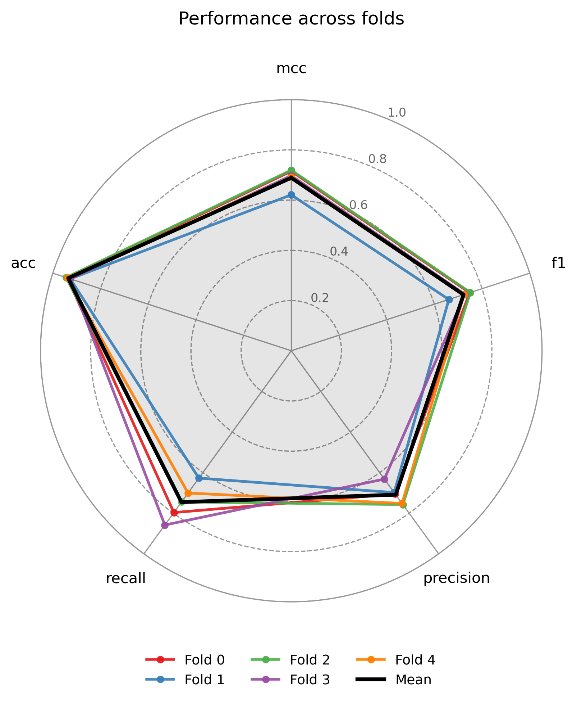

# Von Heijne and evaluation of the method
The Von Heijne method was chosen as a possible method to implement our model. The workflow is contained in the files  _matrix.ipynb_  and _von_heine_metrics.py_.
## Von Heijne method:
The Von Heijne method implements a *Position-Specific Weight Matrix* (PSWM). To build the PSWM a **window of 15 residues** is computed, such that it contains the 13 previous position to the cleavage site and the next 2 position. This window must slide over the first **90 residues** of the protein and compute a **score** for said protein. 

### Extraction of the sequences:
From the FASTA file containing the uniprot ids and fold divisions, the sequences were extracted to obtain:
- *3 TRAINING SETS*: the sequences of these 3 folds were used, extracting only the positive ones.
- *1 VALIDATION SET*
- *1 TEST SET*

In order to repeat the analysis  up to *5 runs*, the pattern to choose the train, validation and test set was: 
- Test= j
- Validation= (j+1)%5
- Train= [(i+j)%5 for i in range(2,5)]

## Building the PSWM
Once the positive sequences were extracted, with the function _create-pswm_ the PSWM is computed.

Said function creates a numpy array with 15 rows and 20 columns:

- one row for each position 
- one column for each ammoinoacid. 

Every cell is initiated at 1.

 
It then iterates over the sequences, considers the 15 residue window around the cleavage site and for each position it updates the count of the amminoacid with the ones present in the sequences. 

To compute the frequency of the ammino acid in each position we must add to the number of sequences 20 (given by the 20 aa initiated at 1). The frequency is divided by the *background frequency* obtrained from UniProt, the result is the logarithm base 2 of this value.

## Scoring the sequence

Each sequence is scored considering a sliding window of 15 residues that slides over the first 90 residues. For each window the weights of the aminoacids present in each position are obtained from the PSWM and summed.

Only the best score is kept for each sequence.

## Threshold choice:

The classification of the sequences in positive and negative is discriminated by a threshold applied to the scores.

The otpimal threshold is chosen taking the one that obtains the best F1 score, using the function _opt_th_.

## Overall Metrics:

Finally the following metrics were computed for each run:

- Matthew Correlation Coefficient
- F1
- Precision
- Recall
- Accuracy
- Confusion Matrix

Finally , for each metric, the mean and standard deviation is computed.

# Results:

### - The __confusion matrixes__ for each run are following reported:

  
  
  
  
  

### - A __Spider plot__ was computed on the mean of the obtained metrics:

    

### All the runs overlaps , there is no significative difference between different folds