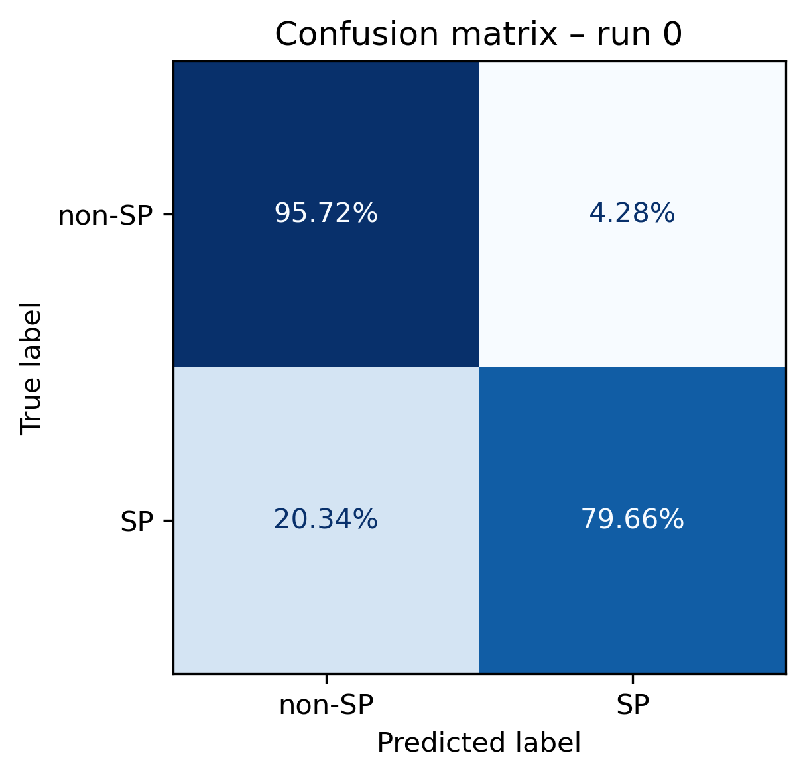

# von Heijne method

Baseline predictor: a position-specific weight matrix (PSWM) built on the region around the cleavage site, as proposed by von Heijne (1986).

| File | Content |
|---|---|
| `von_heijne_metrics.py` | the whole procedure: 5 runs, metrics, confusion matrices, spider plot |
| `matrix.ipynb` | the same procedure step by step (the notebook used to develop it) |
| `spiderplot.ipynb` | spider plot from `vom_heijne_metrics.csv` |
| `merged.fasta` | all the non-redundant sequences (negative, then positive representatives) |
| `vom_heijne_metrics.csv` | metrics of each run |
| `k_fold_stats.csv` | mean and standard error of each metric over the 5 runs |
| `confusion_matrix0.png` … `confusion_matrix4.png`, `spider_plot.png` | plots |

## How to run

```bash
python3 von_Heijne_method/von_heijne_metrics.py --cm y --spider y
```

| Option | Default | Meaning |
|---|---|---|
| `--fasta` | `von_Heijne_method/merged.fasta` | sequences |
| `--data` | `Data_preparation/Cleaned_merged_dataset.tsv` | class, cleavage position and fold of each protein |
| `--df_back` | `Data_analysis/aa_composition_plots/background_freq.tsv` | background amino acid frequencies |
| `--out_dir` | `von_Heijne_method/` | where the results are written |
| `--cm` | `n` | `y` saves the confusion matrix of each run |
| `--spider` | `n` | `y` saves the spider plot |

The default paths are found relative to the script, so it works from any folder.

## Training, validation and test folds

Only the 5 training folds are used; the hold-out test set is kept for the final comparison. With the folds numbered 0–4, in run *j* (0–4):

- **training**: folds (j+2) % 5, (j+3) % 5 and (j+4) % 5; only their positive sequences are used, to build the PSWM;
- **validation**: fold (j+1) % 5, to choose the threshold;
- **test**: fold j, to measure the performance.

Each fold is the test fold exactly once.

## Building the PSWM

From each positive training sequence we take the 15 residues around the cleavage site: 13 before and 2 after (positions −13 to +2). `create_pswm`:

1. starts from a 15 × 20 matrix of ones (pseudocount 1 for every position and amino acid);
2. adds the count of each amino acid at each position, skipping non-standard residues (X, U);
3. divides each row by its total to obtain frequencies (the total is the number of sequences + 20 when no residue is skipped);
4. divides by the Swiss-Prot background frequency of each amino acid and takes the base-2 logarithm.

## Scoring a protein

`score_seq` slides the 15-residue window over the first 90 residues of the protein (windows starting at positions 1 to 76, fewer for proteins shorter than 90), adds up the PSWM weights of the residues in each window and keeps the best window score. Non-standard residues add nothing to the score.

## Threshold and metrics

`opt_th` computes the precision-recall curve of the validation scores and picks the threshold with the highest F1. The test fold is then classified with that threshold (score ≥ threshold means SP) and we compute MCC, F1, precision, recall, accuracy and the confusion matrix normalised by true class. For each metric we report the mean and the standard error over the 5 runs.

## Results

| Metric | Mean ± SE |
|---|---|
| MCC | 0.692 ± 0.018 |
| F1 | 0.725 ± 0.016 |
| Precision | 0.708 ± 0.022 |
| Recall | 0.752 ± 0.041 |
| Accuracy | 0.936 ± 0.003 |

*Values from the last run (`k_fold_stats.csv`); they will be refreshed after re-running the script with the current code.*

Confusion matrices of the 5 runs (each row normalised to the true class):

<p align="center">
  
  
  
  
  
</p>

Spider plot of the metrics of each run and of their mean:

<p align="center">
    
</p>

The runs overlap: there is no significant difference between the folds.
